<p align="center">
  
</p>

<h1 align="center">HopShare</h1>

<p align="center">Find verified people going your way, share one cab, split the fare.</p>

---

**Contents:** [What it is](#what-it-is) · [Status](#status) · [Tech stack](#tech-stack) · [System design](#system-design) · [1. Big picture](#1-big-picture) · [2. One ride end to end](#2-one-ride-end-to-end) · [3. App screens](#3-app-screens) · [4. Sign-in](#4-sign-in-and-tokens) · [5. Places](#5-places-and-maps) · [6. Matching](#6-matching) · [7. Joining](#7-joining-a-group) · [8. Real time and Redis](#8-real-time-socketio-and-redis) · [9. Booking](#9-booking-the-cab) · [10. Safety](#10-safety) · [11. Fare split](#11-fare-split-and-payback) · [12. Database](#12-database) · [13. Deployment](#13-deployment-cost-and-scale) · [14. Trade-offs](#14-trade-offs) · [Project layout](#project-layout) · [Running it locally](#running-it-locally)

## What it is

HopShare groups 2–4 people heading to the same place at the same time. They share one regular cab (Uber, Ola, Rapido or an auto), so each person pays up to 75% less.

One rider books the cab. HopShare opens Uber or Ola with the pickup and drop already filled in. The others pay that rider back their share over UPI. HopShare **never books the cab and never holds money**, which keeps it free to run and legally simple.

It's built for India and is open to anyone who commutes: students, office-goers, people heading to the airport. Version 1 is a portfolio project shipped as an Android APK, with outside services in sandbox mode.

### How it's different

Carpool apps like Hopr (Rapido), Quick Ride and sRide match **car owners** with passengers on their route. HopShare matches **riders without a car** with each other, so it works anywhere cabs run and needs no car owners.

That changes the hard problems:

- **Trust between strangers.** There's no driver in charge, so every rider is ID-verified (DigiLocker), and everyone shares their live location while meeting up.
- **Getting the booker paid back.** One person pays the whole fare. The app splits it evenly, sends each rider a UPI payment link, and shows the booker who has paid.

### Rules the product keeps

- **Value before verification:** anyone can browse groups; ID verification is asked for only when joining or starting one.
- **Privacy by default:** other riders see only first name, photo and badges. Never phone number, last name, address or regular routes.
- **No fake profiles:** every rider is ID-verified before their first shared ride, and the server (not the app) enforces it.
- **Not in v1:** in-app cab booking, a payment gateway, drivers, uneven (distance-based) splits, in-app chat.

## Status

Each part of the design below is marked **Built**, **Planned** (decided, not coded yet) or **Proposed** (a suggested design, not decided yet).

| Area | State |
|---|---|
| Sign-up and login with email + password (Clerk proves the email with a code) | Done |
| Own auth on the server: JWT access + refresh tokens | Done |
| Database schema and migrations (Prisma, PostGIS) | Done |
| Home screen: map, place search, live pickup location | Done |
| One-tap Uber / Ola booking with the route filled in | Done (not yet on a screen) |
| Matched groups screen, join requests, 1 km matching | Next |
| Google sign-in | Later |
| Live location, group updates (Socket.io, Redis) | Planned |
| DigiLocker verification, fare split and UPI payback | Planned |

## Tech stack

| Part | Built with |
|---|---|
| Mobile app | React Native (Expo), TypeScript, Expo Router |
| API | Node.js, Express |
| Database | PostgreSQL + PostGIS on Neon, Prisma |
| Sign-in | Email + password (bcrypt, our DB); Clerk proves the email with a code; our own JWT access + refresh tokens |
| Maps and places | MapLibre + OpenFreeMap tiles, Photon (OpenStreetMap) search |
| Real-time (planned) | Socket.io, Upstash Redis |
| ID verification (planned) | DigiLocker through an aggregator |
| Hosting (planned) | Render / Koyeb |

---

# System design

## 1. Big picture

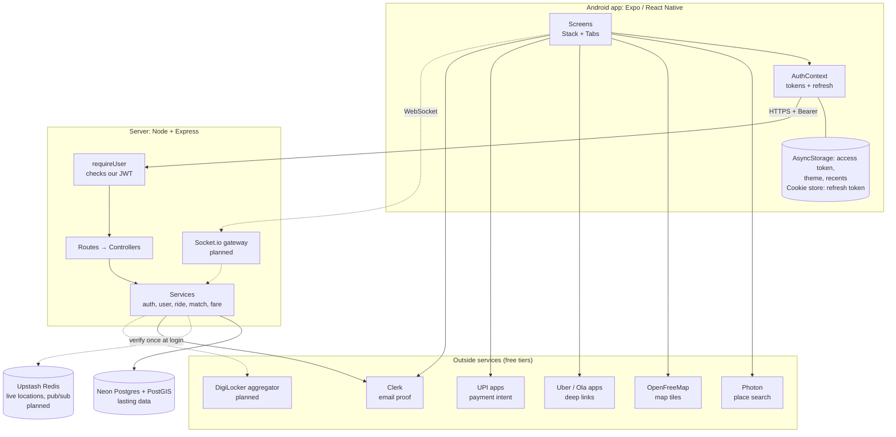

Solid lines are built; dotted lines are planned.

| Part | Job | State |
|---|---|---|
| Expo app | All screens, GPS, maps, opening cab and UPI apps | Built: sign-in, profile setup, home map + search |
| Express API | Auth, profile, rides, matching, join requests, fares | Built: auth + `/api/me` |
| Socket.io | Group updates and live location in real time | Planned |
| Postgres + PostGIS (Neon) | Users, rides, join requests, payments; 1 km geo queries | Built (schema) |
| Redis (Upstash) | Short-lived live locations, pub/sub between server instances | Planned |
| Clerk | Proves an email (code) or Google account at sign-up and reset. Nothing else | Built |
| Photon / OpenFreeMap | Place search, reverse geocoding, map tiles | Built (called from the app) |
| DigiLocker aggregator | ID verification before joining a group | Planned |

**Server layering:** `routes → controllers → services → Prisma`. Controllers only read the request and shape the response; all rules live in services, so socket handlers can reuse them. Every error is `{ "success": false, "message": "..." }`.

## 2. One ride end to end

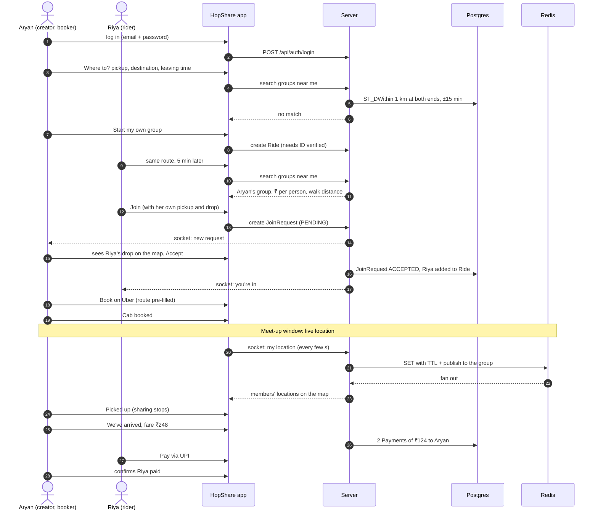

The same journey as ride states:

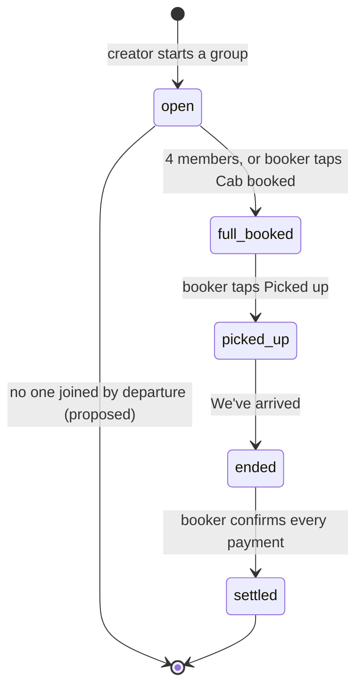

- Each rider taps **I'm in the cab** at pickup. Anyone not checked in when the booker marks pickup (after about 5 minutes of waiting) is a **no-show**: left out of the split, given a reliability mark, and able to dispute it.
- A group that never fills can still ride with 2–3 people; the split adjusts.
- A user can be in only one active group at a time.

## 3. App screens

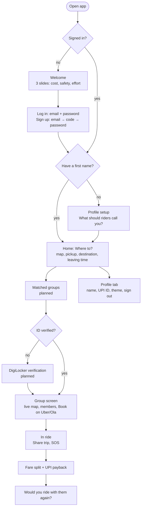

Navigation is kept simple: a root `Stack`, a `Tabs` bar (Home, Profile), and a `Stack` inside each tab. Built so far: Welcome, Sign in, Profile setup, Home.

## 4. Sign-in and tokens

**Built.** Passwords are ours: the server stores a bcrypt hash and checks it at login. Clerk is used like a small service for one job: proving someone owns an email (a 6-digit code) or a Google account. After any way in, HopShare issues its own two signed JWTs. Nothing about a sign-in is stored in the database.

Three ways in, one ending:

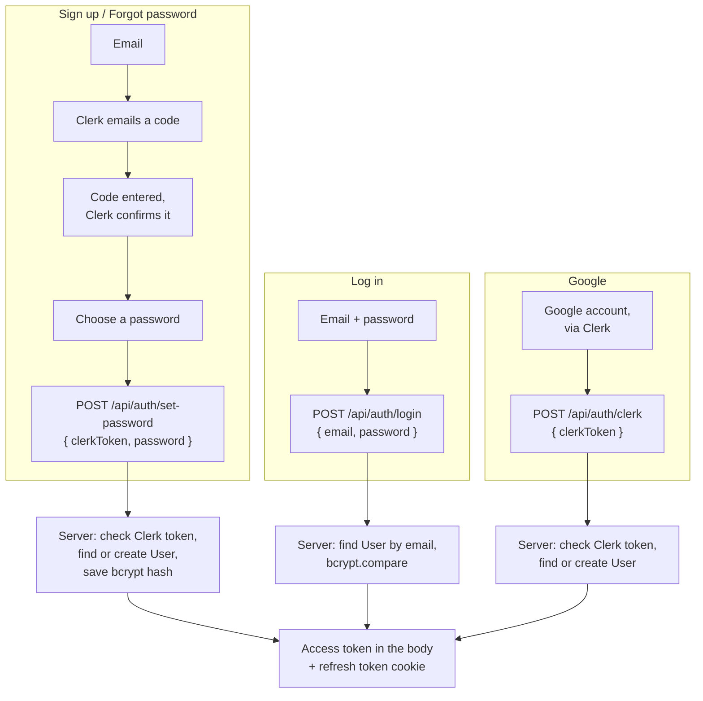

The same flow over time, from sign-up to a refresh:

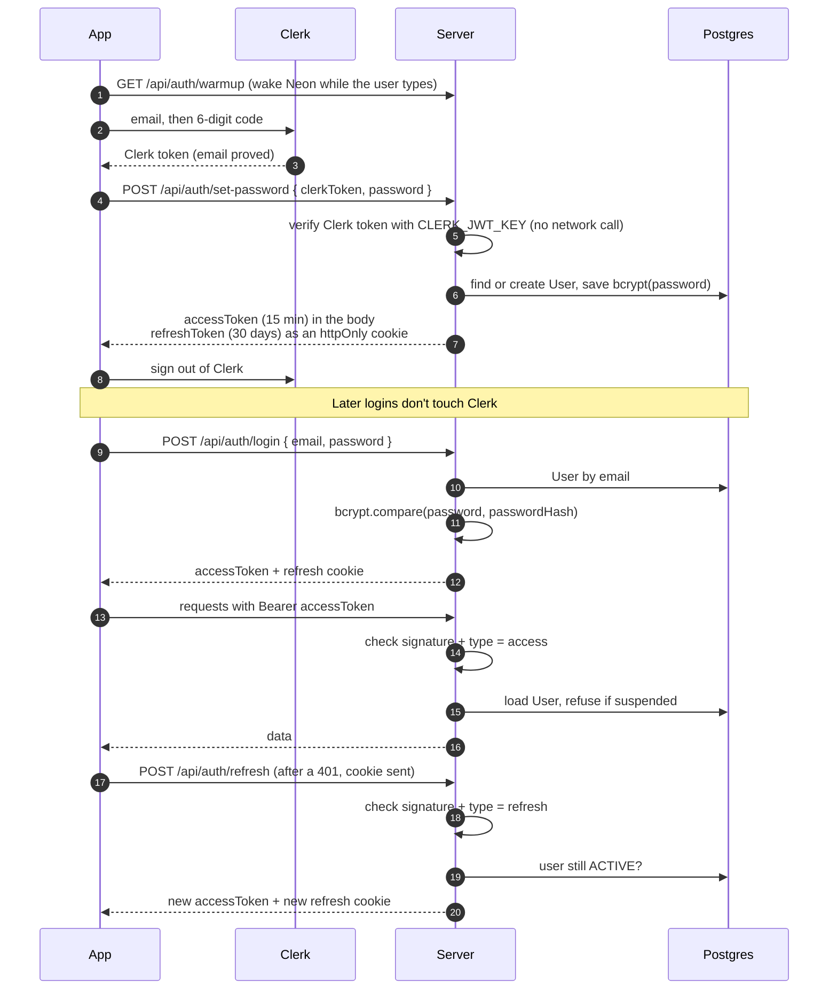

How a refresh token is checked:

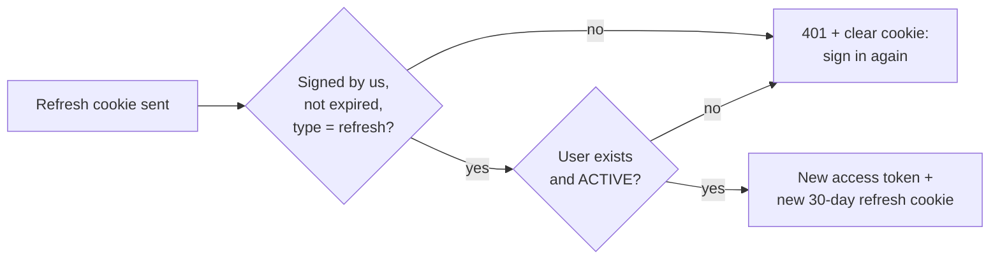

- **Access token:** JWT `{ sub: userId, type: "access" }`, 15 minutes, signed with `JWT_SECRET`. `requireUser` checks the signature, then loads the user and refuses suspended accounts.
- **Refresh token:** JWT `{ sub: userId, type: "refresh" }`, 30 days, same secret. The `type` claim stops one kind of token being used as the other. Each refresh gives a new one, so an active user's 30 days keep moving forward.
- **Where the tokens live:** the access token is kept in AsyncStorage and sent as `Authorization: Bearer <token>` on every request. The refresh token is never seen by app code: the server sets it as an `httpOnly` cookie (`Path=/api/auth`, `SameSite=Strict`, `Secure` in production, expiring with the token), and the phone's cookie store sends it back to `/api/auth/refresh` and `/api/auth/logout` by itself.
- **Logout:** clears the cookie, and the app forgets its access token. Because nothing is stored, the server can't cancel a token that was copied off the phone: it stays valid until it expires. Suspension still works, because every request and refresh checks the user's status.
- **Many devices:** each sign-in gets its own tokens, so several phones can be signed in at once. Listing or signing out other devices needs stored sessions, which are left for later.
- **App side:** on a 401 the app refreshes **once** (parallel requests share the same refresh), then retries.
- **Passwords:** at least 8 characters, at most 72 bytes (bcrypt only reads 72, so longer ones are refused rather than silently cut). Stored only as a bcrypt hash (10 rounds, salted) in `User.passwordHash`; never returned by the API.
- **Wrong email or wrong password** get the same answer, "Email or password is incorrect.", and take the same time (an unknown email is still checked against a dummy hash), so no one can learn which emails have accounts.
- **Forgot password** is the sign-up path again: a fresh email code proves the inbox, then the new password replaces the old hash. Accounts made before passwords existed set theirs this way once.
- **Google accounts** have no password (`passwordHash` stays empty) and sign in through Clerk each time.
- **After sign-up** the app asks only for a first name; the UPI ID is asked for only when someone becomes the booker.
- **Not yet:** a limit on login attempts. Worth adding before real users, since passwords can be guessed.

| Route | Does |
|---|---|
| `GET /api/auth/warmup` | Wakes the database when the sign-in screen opens |
| `POST /api/auth/login` | Email + password → our tokens |
| `POST /api/auth/set-password` | Clerk token (email proved by code) + new password → saves the hash, gives our tokens. Used for sign-up and forgot password |
| `POST /api/auth/clerk` | Clerk token from Google sign-in → our tokens |
| `POST /api/auth/refresh` | Gives a new token pair |
| `POST /api/auth/logout` | Clears the refresh cookie |
| `GET` / `PATCH /api/me` | Reads / updates your profile (first name) |

## 5. Places and maps

**Built.**

- Pickup defaults to GPS (`expo-location`), named with Photon reverse geocoding. The destination comes from Photon type-ahead, biased to the user's position.
- Map: MapLibre with OpenFreeMap tiles (free, no key), light and dark styles, pickup dot, drop pin, dashed route line.
- "Leaving": Now, or a time within the next 2 hours.
- The last 5 destinations are kept on the phone (AsyncStorage), since commutes repeat.
- **Planned:** move Photon behind `/api/places` so the app doesn't depend on a third-party URL and results can be cached.

## 6. Matching

**Planned.** A group matches when **both** ends are close and the time fits:

- the group's pickup is within **1 km** of my pickup,
- the group's destination is within **1 km** of my destination,
- it leaves within **±15 minutes** of my leaving time, is still `joinable`, and has fewer than 4 members.

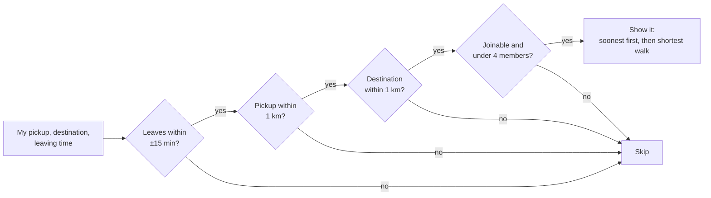

```sql
SELECT r.id, r."sourceName", r."destinationName", r.time,
       ST_Distance(r.source, ST_MakePoint($pickLon, $pickLat)::geography) AS walk_m
FROM "Ride" r
WHERE r.joinable
  AND r.time BETWEEN $leaving - interval '15 min' AND $leaving + interval '15 min'
  AND ST_DWithin(r.source,      ST_MakePoint($pickLon, $pickLat)::geography, 1000)
  AND ST_DWithin(r.destination, ST_MakePoint($dropLon, $dropLat)::geography, 1000)
ORDER BY r.time, walk_m
LIMIT 20;
```

- Points are `geography(Point, 4326)`, always `[lon, lat]`, so distances come out in metres.
- `ST_DWithin` can use a **GIST index** on `source` and `destination`. The indexes are left out for now (tiny data); they're the first thing to add when matching gets slow.
- Each card shows destination, estimated cost per person, walk distance, departure time, members ("2 of 4") and badges. If nothing fits: **Start my own group**.

## 7. Joining a group

**Planned (table built).**

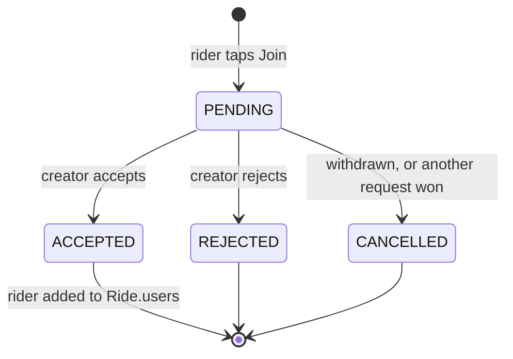

- The request stores the rider's **own** pickup and drop, so the creator can see on a map whether the detour makes sense before accepting.
- Accept runs in one transaction: check the ride is still joinable and has room, mark the request `ACCEPTED`, add the member, set `joinable = false` at 4.
- **Proposed:** a rider may have several pending requests; the first accept wins and the others become `CANCELLED`.

## 8. Real time: Socket.io and Redis

**Planned.** The socket handshake sends the same access token as HTTP and goes through the same check as `requireUser`. Each member joins a room per ride, `ride:<rideId>`.

**Proposed events:**

| Event | From → to | When |
|---|---|---|
| `join-request:new` | server → creator | a rider asks to join |
| `join-request:answered` | server → rider | accepted / rejected |
| `ride:updated` | server → room | member joins/leaves, cab booked, picked up, ended |
| `location:update` | phone → server → room | every few seconds, meet-up window only |
| `payment:updated` | server → room | someone paid / booker confirmed |

### Why Redis

Postgres holds everything that must last: users, rides, join requests, payments. Live location while a group meets up is different:

- **It changes every few seconds and is useless a minute later.** Writing it into Postgres would mean constant writes to rows nobody reads again, and serverless Neon would never get to sleep.
- **It should disappear on its own.** Location isn't kept beyond the active ride. In Redis each position is stored with a TTL (e.g. `loc:<rideId>:<userId>`, 60 s), so it expires by itself.
- **Updates have to reach every server.** With more than one server instance, two members of the same group can be connected to different ones. Redis pub/sub (the Socket.io Redis adapter) passes each update to all instances.


Rule of thumb: if losing it on a restart doesn't matter and it expires within minutes, it goes in Redis. Everything else goes in Postgres.

**When location is shared:** from "group full / cab booked" until "picked up", for everyone in the group. After that, only a rider who taps **Share trip** or **SOS** keeps streaming. On the phone, incoming locations update the map markers without re-rendering the whole screen, because they arrive several times a second across a group.

## 9. Booking the cab

**Built, not yet on a screen.** Uber's and Ola's ride APIs are for partners only, so HopShare hands off instead:

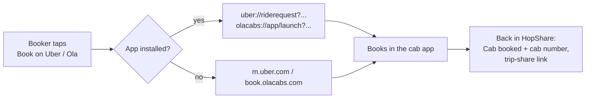

Rapido has no public deep link; the plan is an "Open Rapido" button plus a copy button for the destination.

## 10. Safety

**Planned.**

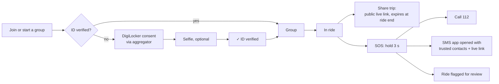

- **Verification:** HopShare keeps only name, date of birth (18+ check) and a verified flag, never the Aadhaar number, address or documents. Badges: **✓ ID verified** (required) and **✓ Photo verified** (optional selfie match).
- **SOS** does **not** alert the rest of the group, since the threat may be in the cab. Automatic server-sent SMS needs a paid provider, so v1 opens the SMS app for the user to send.
- **Moderation:** SOS flags, reports, disputed no-shows and unpaid rides go to a moderation table. No admin UI in v1; a protected admin endpoint can suspend a user, and suspended users can't sign in.
- **Feedback** after a ride: "Would you ride with them again?" 👍 / 👎 plus tags (On time, Paid quickly, Friendly). No star ratings. Shown on profiles only after 5 rated rides.

## 11. Fare split and payback

**Planned.**

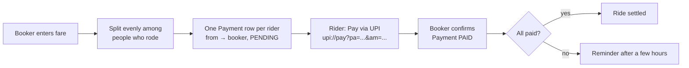

- Even split, no-shows left out. Amounts are worked out in paise (integers) to avoid rounding errors. **Proposed:** any leftover paise stay with the booker.
- HopShare never moves money: the UPI intent opens the rider's own UPI app with the booker's UPI ID and amount. A copyable UPI ID and QR code are the fallback, since some UPI apps block these links. If the UPI app reports success, the row shows "probably paid"; the **booker's confirmation** is the truth.
- The booker must have a UPI ID on their profile. Payments sit behind one service, so a gateway (e.g. Razorpay) could be added later without changing screens.

## 12. Database

Postgres + PostGIS on Neon, managed with Prisma (`server/prisma/schema.prisma`). Points are `geography(Point, 4326)`, written `ST_MakePoint(lon, lat)`.

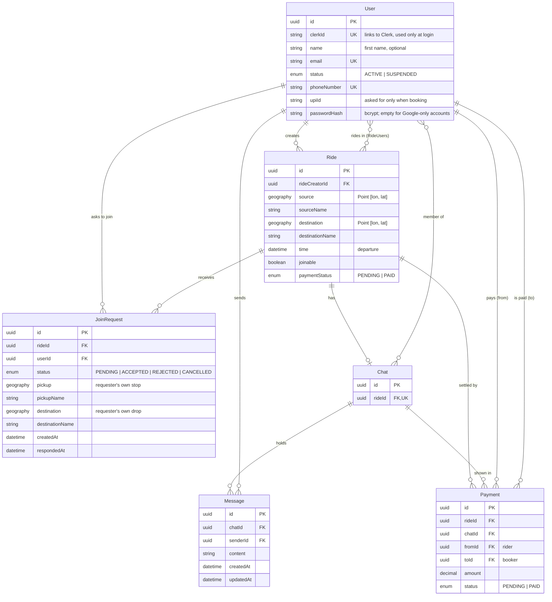

| Parent deleted | Children deleted with it |
|---|---|
| `Ride` | `Chat`, `Payment`, `JoinRequest` |
| `Chat` | `Message`, `Payment` |

| Migration | What it did |
|---|---|
| `20261102180616_init` | First tables |
| `20261103074653_default_table_names_text_ids` | Prisma default table names, text ids |
| `20261104090000_clerk_id_camel_case_columns` | `User.clerkId`, dropped password, camelCase columns |
| `20261106090000_ride_place_names` | `Ride.sourceName`, `destinationName` |
| `20261106120000_join_requests` | `JoinRequest` table and status enum |
| `20261107090000_sessions` | `Session` table for our own auth |
| `20261120090000_drop_sessions` | Dropped `Session`: refresh tokens are stateless JWTs for now |
| `20261120120000_user_password_hash` | `User.passwordHash` for email + password login |

Not in the schema yet: GIST indexes on ride points, ID verification fields, feedback, trusted contacts, moderation cases. `Chat` and `Message` exist from the first draft, but in-app chat is out of scope for v1.

## 13. Deployment, cost and scale

| Piece | Where | Cost |
|---|---|---|
| App | Android APK (Expo development build) | Free |
| API + sockets | Render / Koyeb free tier | Free |
| Postgres + PostGIS | Neon serverless | Free tier |
| Redis | Upstash serverless | Free tier |
| Auth, maps, search | Clerk, OpenFreeMap, Photon | Free |

Free tiers sleep when idle, so the server and Neon may need a few seconds to wake. The warmup call on the sign-in screen hides that wait.

If it grew:

1. Add GIST indexes on ride points, so matching stays fast.
2. Run more than one server instance: possible because auth is stateless JWT and sockets share state through Redis.
3. Run our own Photon, or cache searches behind `/api/places`.

## 14. Trade-offs

| Decision | Why | Cost of it |
|---|---|---|
| Hand off to Uber/Ola instead of booking | No partner API access; no liability | Can't read trip status; booker taps "Cab booked" |
| UPI links instead of a payment gateway | Free, no KYC, never hold others' money | Payment isn't guaranteed; booker confirms |
| Own passwords and tokens; Clerk only proves the email | Login doesn't depend on Clerk; full control over accounts and suspension | We own password security: hashing, generic errors, and (still to add) attempt limits |
| Stateless JWT refresh tokens (no session table) | Nothing to store or clean up; many devices just work | Logout can't cancel a copied token; no device list or sign-out-everywhere |
| Email code instead of phone OTP | Free (SMS to +91 numbers costs money) | Phone number isn't verified |
| Redis for live location | Fast, auto-expiring, works across servers | One more service to run |
| Even split only | Simple and easy to trust | Unfair if someone gets off much earlier |
| PostGIS on both ends of the ride | One SQL query, real distances in metres | Needs `[lon, lat]` discipline and indexes later |

---

## Project layout

```
client/   Expo app: screens in src/app (Stack + Tabs), components, context, hooks, services
server/   Express API: src/{config,controllers,middleware,routes,services}, prisma/ schema and migrations
docs/     schema/ first schema draft (image)
```

## Running it locally

You need Node.js 22+, a PostgreSQL database with PostGIS (a free Neon project works), and a Clerk application.

**Server**

```bash
cd server
cp .env.example .env      # fill in DATABASE_URL, JWT_SECRET, CLERK_SECRET_KEY, CLERK_JWT_KEY
npm install
npm run migrate           # applies the Prisma migrations
npm run dev               # http://localhost:4000
```

**App**

```bash
cd client
cp .env.example .env      # fill in EXPO_PUBLIC_CLERK_PUBLISHABLE_KEY
npm install
npm run android           # or: npm run ios
```

While developing, leave `EXPO_PUBLIC_API_URL` empty: the app calls the computer running Metro on port 4000. Set it only for a deployed server.

The server won't start without `DATABASE_URL`, `JWT_SECRET` and `CLERK_SECRET_KEY`. `CLERK_JWT_KEY` (from the Clerk dashboard) lets the server check Clerk tokens without a network call.

The app uses native modules, so it runs as a development build (`npm run android` / `npm run ios`). It doesn't run in Expo Go.
