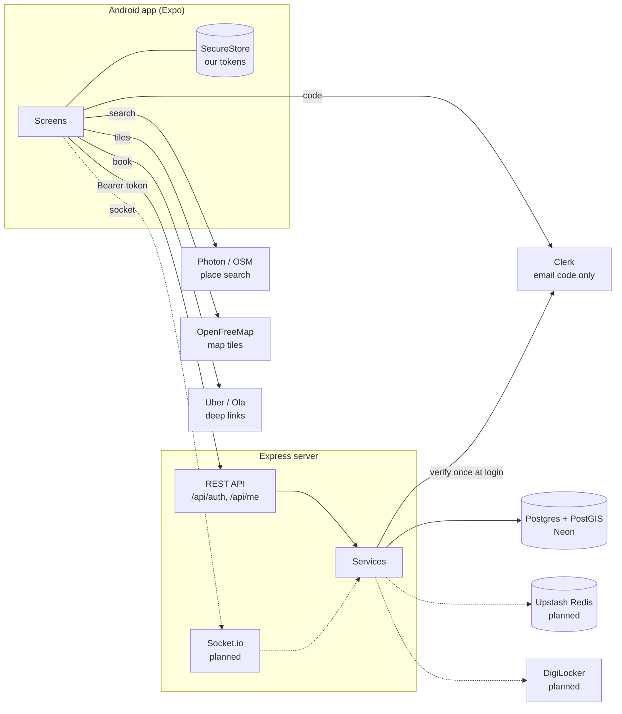
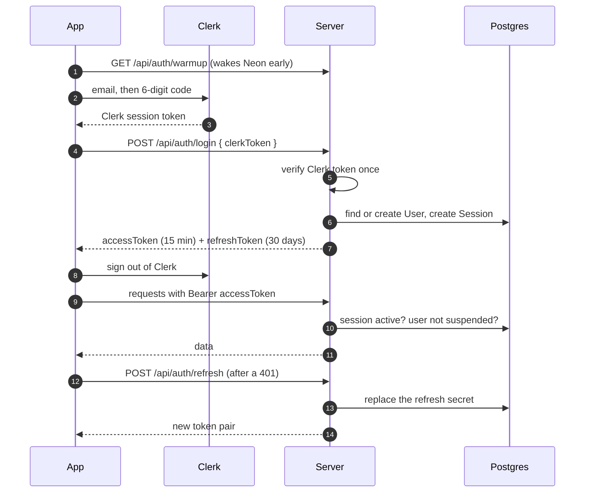
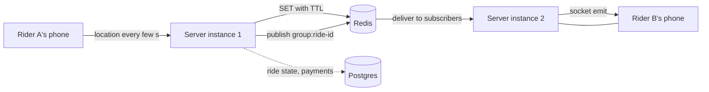
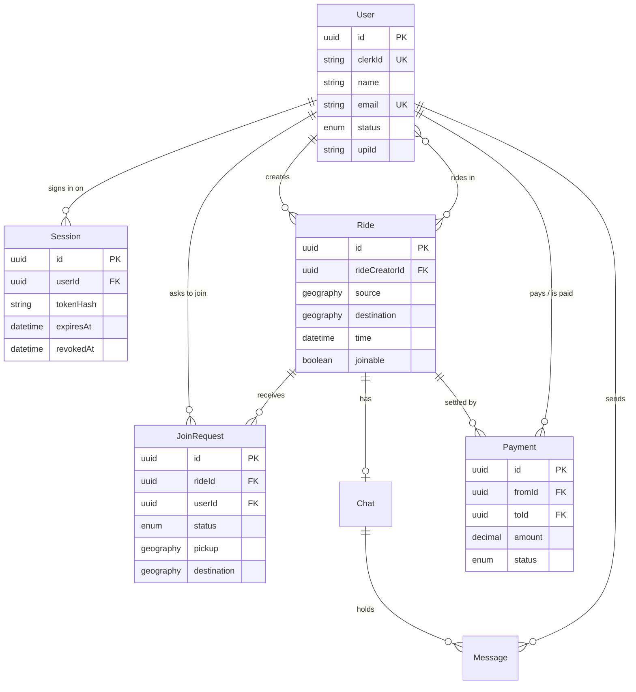

<p align="center">
  
</p>

<h1 align="center">HopShare</h1>

<p align="center">Find verified people going your way, share one cab, split the fare.</p>

---

## What it is

HopShare groups 2–4 people heading to the same place at the same time. They share one regular cab (Uber, Ola, Rapido or an auto), so each person pays up to 75% less.

One rider books the cab. HopShare opens Uber or Ola with the pickup and drop already filled in. The others pay that rider back their share over UPI.

It's built for India and is open to anyone who commutes: students, office-goers, people heading to the airport.

## How it's different

Carpool apps like Hopr (Rapido), Quick Ride and sRide match **car owners** with passengers on their route. HopShare matches **riders without a car** with each other, so it works anywhere cabs run and needs no car owners.

That changes the hard problems:

- **Trust between strangers.** There's no driver in charge, so every rider is ID-verified (DigiLocker), and everyone shares their live location while meeting up.
- **Getting the booker paid back.** One person pays the whole fare. The app splits it evenly, sends each rider a UPI payment link, and shows the booker who has paid.

## Status

| Area | State |
|---|---|
| Sign-in with an email code (Clerk checks the code) | Done |
| Own auth on the server: access + refresh tokens, sessions per device | Done |
| Database schema and migrations (Prisma, PostGIS) | Done |
| Home screen: map, place search, live pickup location | Done |
| One-tap Uber / Ola booking with the route filled in | Done (not yet on a screen) |
| Matched groups screen, join requests, 1 km matching | Next |
| Google sign-in | Later |
| Live location, group updates (Socket.io, Redis) | Planned |
| DigiLocker verification, fare split and UPI payback | Planned |

## Tech stack

| Part | Built with |
|---|---|
| Mobile app | React Native (Expo), TypeScript, Expo Router |
| API | Node.js, Express |
| Database | PostgreSQL + PostGIS on Neon, Prisma |
| Sign-in | Clerk email code, then our own JWT access + refresh tokens |
| Maps and places | MapLibre + OpenFreeMap tiles, Photon (OpenStreetMap) search |
| Real-time (planned) | Socket.io, Upstash Redis |
| Hosting (planned) | Render |

Version 1 ships as an Android APK.

## System design



Solid lines are built; dotted lines are planned. HopShare never books the cab itself: it opens the cab app with the route filled in.

### Sign-in

Clerk only checks the email code. After that the server runs auth itself: it hands out a short-lived access token and a refresh token that changes every time it's used.



- Only a SHA-256 hash of the refresh secret is stored. Reusing an old refresh token revokes that device's session.
- Logout (`/api/auth/logout`, `/api/auth/logout-all`) works at once, because every request checks the session.

| Route | Does |
|---|---|
| `GET /api/auth/warmup` | Wakes the database when the sign-in screen opens |
| `POST /api/auth/login` | Swaps a Clerk token for our tokens |
| `POST /api/auth/refresh` | Gives a new token pair |
| `POST /api/auth/logout` | Signs out this device |
| `POST /api/auth/logout-all` | Signs out every device |
| `GET` / `PATCH /api/me` | Reads / updates your profile (first name) |

### Why Redis (planned)

Postgres holds everything that must last: users, rides, join requests, payments. Live location while a group meets up is different, and that's what Redis (Upstash) is for:

- **It changes every few seconds and is useless a minute later.** Each member's phone sends its position every few seconds during the pickup window. Writing that into Postgres would mean constant writes to rows nobody reads again, and Neon (serverless) would never get to sleep.
- **It should disappear on its own.** The spec promises location isn't kept beyond the active ride. In Redis each position is stored with a TTL, so it expires by itself, and nothing has to clean up Postgres.
- **Messages have to reach every server.** With more than one server instance, two members of the same group can be connected to different instances. Redis pub/sub (the Socket.io Redis adapter) passes each update to all instances, so everyone in the group gets it.



Rule of thumb: if losing it on a restart doesn't matter and it expires within minutes, it goes in Redis. Everything else goes in Postgres.

### Database



Points are PostGIS `geography(Point, 4326)`, written `[lon, lat]`. The full schema, with every field, the join request and session states, and the migrations, is in [docs/schema/schema.md](docs/schema/schema.md).

## Project layout

```
client/   Expo app: screens in src/app (Stack + Tabs), components, hooks, services
server/   Express API: src/{config,controllers,middleware,routes,services}, prisma/ schema and migrations
docs/     Design spec, plans, and the database schema (docs/schema)
```

## Running it locally

You need Node.js 22+, a PostgreSQL database with PostGIS (a free Neon project works), and a Clerk application.

**Server**

```bash
cd server
cp .env.example .env      # fill in DATABASE_URL, JWT_SECRET, CLERK_SECRET_KEY, CLERK_JWT_KEY
npm install
npm run migrate           # applies the Prisma migrations
npm run dev               # http://localhost:4000
```

**App**

```bash
cd client
cp .env.example .env      # fill in EXPO_PUBLIC_CLERK_PUBLISHABLE_KEY
npm install
npm run android           # or: npm run ios
```

While developing, leave `EXPO_PUBLIC_API_URL` empty: the app calls the computer running Metro on port 4000. Set it only for a deployed server.

The server won't start without `DATABASE_URL`, `JWT_SECRET` and `CLERK_SECRET_KEY`. `CLERK_JWT_KEY` (from the Clerk dashboard) lets the server check Clerk tokens without a network call.

The app uses native modules, so it runs as a development build (`npm run android` / `npm run ios`). It doesn't run in Expo Go.
