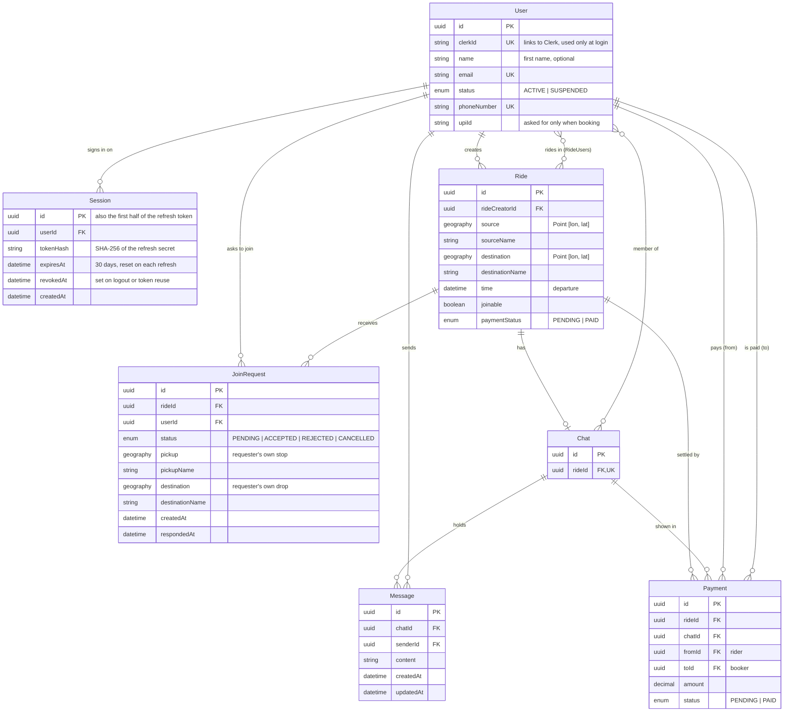
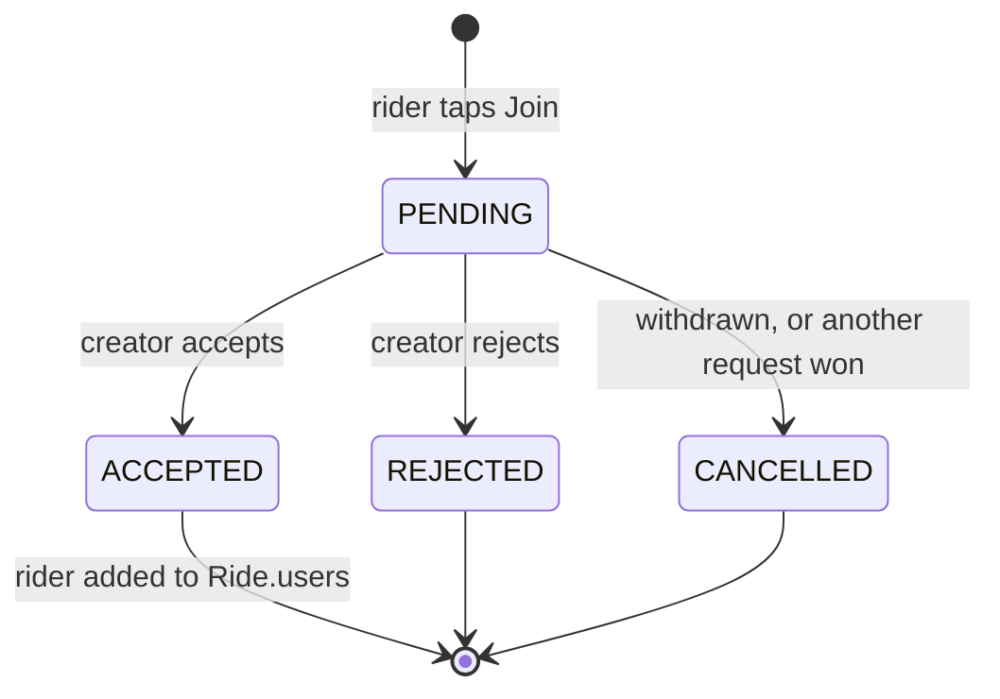
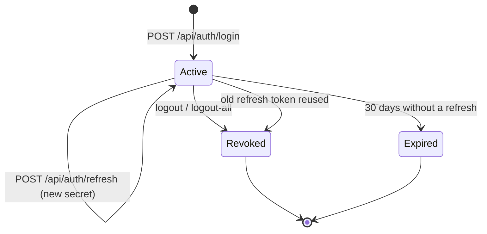

# HopShare database schema

Updated 2026-11-19. Source of truth: `server/prisma/schema.prisma`.
`2026-11-02-schema-draft-v3.png` is the first draft and is kept for history; it predates `clerkId`, place names,
`JoinRequest` and `Session`.

Postgres + PostGIS on Neon. Points are `geography(Point, 4326)`, always written `ST_MakePoint(lon, lat)`.

## Tables and relations

## Join request lifecycle

`respondedAt` is set when the request leaves `PENDING`. Once accepted, the row keeps where that member gets on and off.

## Session lifecycle

One row per signed-in device. `requireUser` checks the session on every request, so revoking it signs the device out at once.

## Delete behaviour

| Parent deleted | Children |
|---|---|
| `User` | `Session` rows deleted (cascade) |
| `Ride` | `Chat`, `Payment`, `JoinRequest` deleted (cascade) |
| `Chat` | `Message`, `Payment` deleted (cascade) |

## Migrations

| Migration | What it did |
|---|---|
| `20261102180616_init` | First tables from the draft |
| `20261103074653_default_table_names_text_ids` | Prisma default table names, text ids |
| `20261104090000_clerk_id_camel_case_columns` | `User.clerkId`, dropped password, camelCase columns |
| `20261106090000_ride_place_names` | `Ride.sourceName`, `destinationName` |
| `20261106120000_join_requests` | `JoinRequest` table and status enum |
| `20261107090000_sessions` | `Session` table for our own auth |

## Not yet in the schema

- GIST indexes on `Ride.source` / `Ride.destination` (left out on purpose; add when 1 km matching needs speed).
- ID verification fields (DigiLocker), feedback, trusted contacts, moderation cases (spec 4.7, 4.11, 4.15).
