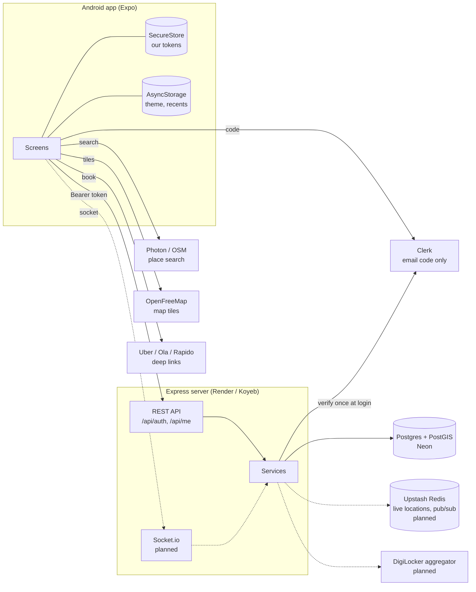
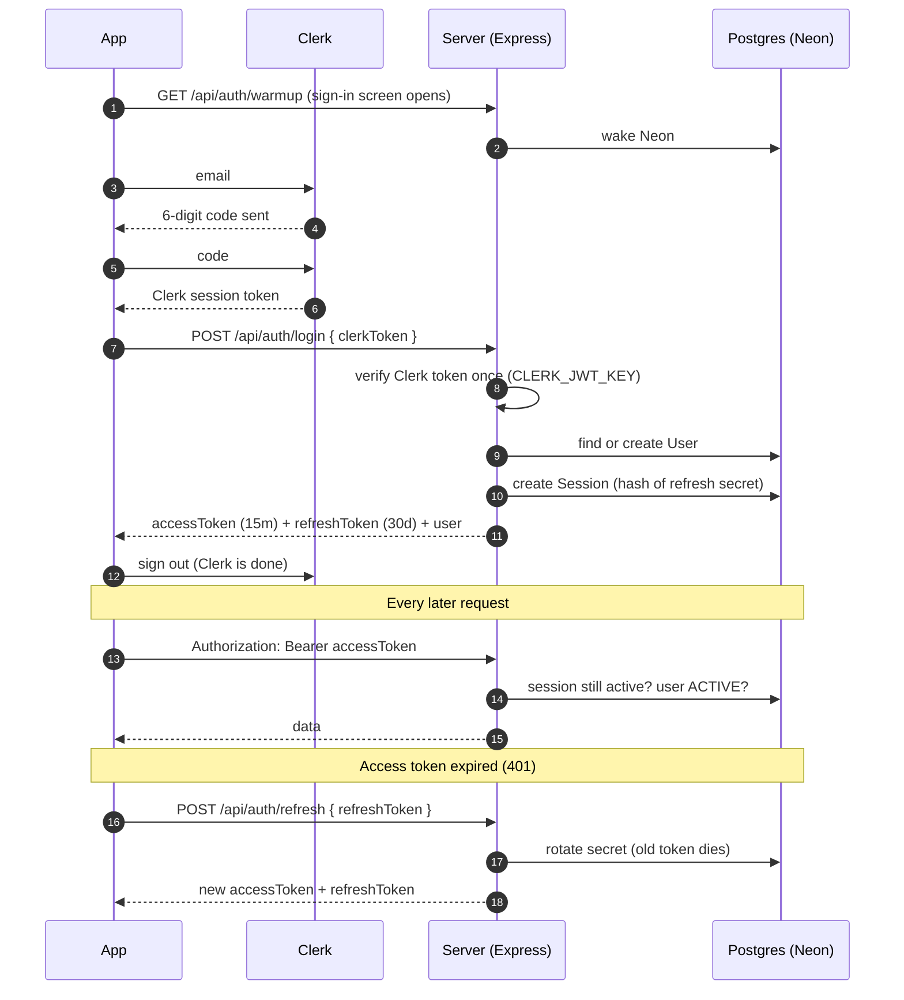
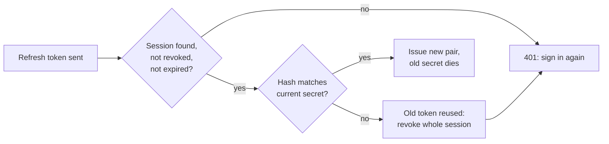

# HopShare — Mobile App Design

**Date:** 2026-10-26
**Status:** Draft for approval
**Scope:** v1 of the HopShare mobile app (Expo client + Express server)

Items marked *(Claude's call)* are defaults chosen during design that the owner did not explicitly decide; they can be changed.

---

## 1. Intent and why

HopShare matches people (not only students — anyone commuting) who are going the same way at the same time, so they can share one cab and split the fare up to four ways. Riders book the cab themselves in an outside app (Uber, Ola, Rapido, auto); HopShare handles finding the group, coordinating the pickup, keeping everyone safe, and splitting the cost.

The project is also a portfolio piece. It should **demonstrate product thinking** to product-company recruiters: every screen exists for a stated reason, the trade-offs are deliberate and explainable, and the app addresses the real worries of sharing a cab with strangers (cost, safety, effort, getting paid back).

Launch market: **India** (designed for it).

**Delivery:** v1 is a **personal portfolio project, distributed as an Android APK**, not released to the Play Store or App Store. This means:
- **Android only** for v1; iOS is out of scope.
- External services run in **sandbox/test mode** (DigiLocker aggregator sandbox, Clerk development instance).
- An Expo **development build** is fine, which allows background location and the UPI intent result.
- Store-review requirements (background-location justification, privacy listings) don't apply, but the app should still behave as if they did.

## 2. Goals, non-goals, anti-goals

**Goals**
- A new user can go from first launch to a joined group in a few minutes.
- Every rider is a verified, real person (DigiLocker ID check) before their first shared ride.
- The fare split is transparent and the booker reliably gets paid back.
- Riders feel safe: live location while meeting up, trip sharing with trusted contacts, an SOS.
- Light and dark mode, both first-class.

**Non-goals (v1)**
- HopShare does not book cabs or integrate with Uber/Ola APIs.
- HopShare does not hold or move money (no payment gateway in v1).
- No in-app drivers.
- No distance-based (uneven) fare splitting.
- No in-app chat *(Claude's call — coordination happens via the live map and status; revisit if needed)*.

**Anti-goals (a failure even if it "works")**
- Fake or anonymous profiles riding with others.
- Exposing riders' phone numbers, last names, addresses or regular routines to other users.
- A verification wall at sign-up that makes people abandon the app before they've seen any value.
- Generic filler copy; every line of text should carry a point.

## 3. Constraints

- **Stack (from CLAUDE.md, updated):** Expo/React Native client (TypeScript, expo-router, existing scaffold in `client/`), Node/Express server (`server/`), PostgreSQL + PostGIS on **Neon**, Upstash Redis, Socket.io, OpenStreetMap/Nominatim.
- **Auth (updated 2026-11-19):** **Clerk verifies the email code only**; the server owns auth after that. `POST /api/auth/login` checks the Clerk token once, then issues our own access token (JWT, 15 min) and a refresh token (30 days, rotated on every use, stored hashed in `Session`). Express (`requireUser`) and the Socket.io handshake verify **our** access token, not Clerk's. Google sign-in is deferred to the end of v1. See section 6.1.
- **ID verification:** **DigiLocker**, accessed through an aggregator (e.g. Setu, Surepass, Cashfree) because direct DigiLocker access requires a registered organisation. v1 may run on the aggregator's sandbox.
- **Zero cost to run** where possible (free tiers, no per-transaction fees).
- **No secrets in code** — everything via `.env`.
- Express errors always return `{ "success": false, "message": "..." }`.
- PostGIS points are always `[lon, lat]`; GIST index on geography columns. Neon needs `CREATE EXTENSION IF NOT EXISTS postgis;`.

## 4. The experience, screen by screen

Mockups from the design session live in `.superpowers/brainstorm/` (git-ignored, for reference).

### 4.1 Welcome / onboarding
- 3 swipeable slides with short lines, each answering one worry:
  - **Cost:** "Same road. Quarter the fare."
  - **Safety:** "Verified people. Shared live location."
  - **Effort:** "You book the cab. We do the math."
- Buttons: **Get started** (sign up) and **I have an account** (log in).

### 4.2 Sign up / log in (Clerk email code)
- **Email + 6-digit code** is the only sign-in in v1 (updated 2026-11-19). Phone OTP was dropped (Clerk SMS for +91 isn't free); Google sign-in is deferred to the end of v1.
- One flow for everyone: try sign-in, and if Clerk says the email is unknown, create the account instead.
- After sign-up: first name only ("What should riders call you?"). UPI ID is asked for only when someone becomes the booker.
- Returning users: email → code → Home.

### 4.3 Home — "Where to?"
- Map at the top; pickup defaults to current GPS location (editable).
- Destination search via Nominatim.
- **Leaving:** "Now" (default) or a picked time within the next 2 hours *(Claude's call)*. Matching only shows groups departing within **±15 minutes** of this time.
- Recent destinations listed first, since commutes repeat.
- **Find riders** button.

### 4.4 Matched groups
- List of open groups whose pickup is within **1 km** of the user and whose destination is within **1 km** of the user's destination *(Claude's call on destination radius)*.
- Each card shows: destination, **estimated per-person cost**, **walk distance to pickup**, **departure time**, member avatars, "2 of 4", verified badges.
- Ordering *(Claude's call)*: soonest departure first, then shortest walk.
- **Start my own group** if nothing fits.
- Browsing works without ID verification.

### 4.5 Creating a group *(Claude's call — details not discussed)*
- Creator sets pickup point, destination, and departure time ("now" or a time within the next 2 hours).
- Creator is the **booker** by default.
- Group is open until 4 members or departure time.

### 4.6 Joining → verification gate
- Tapping **Join group** (or **Start my own group**) checks verification. If unverified, the verification flow starts; on success the user lands back on the exact group they tried to join.

### 4.7 Verification (DigiLocker)
1. **The ask:** "Everyone in HopShare is a real, verified person. That includes you. ~60 seconds, once." Option to continue browsing instead.
2. **What we see / don't see:**
   - Received: name, date of birth (18+ check), gender (optional, for future women-only groups).
   - Never stored: Aadhaar number, address, documents.
   - Other riders see only first name, photo and badge.
3. **DigiLocker consent** in an in-app browser (government/aggregator screen).
4. **Selfie — optional.** Skippable. If taken and it matches the DigiLocker photo, the user gets a second badge. Face matching can be deferred to v2 if the aggregator doesn't provide it cheaply.
5. **Verified** confirmation → back to the group.

Badges: **✓ ID verified** (required to ride) and **✓ Photo verified** (optional).
Verification status is stored on the user in our database (Clerk is not involved after login). The server — not the client — enforces "verified to join/create".

### 4.8 Group screen (before pickup)
- Meeting point, cab ETA once booked, who's booking.
- Live map of group members from **group full** (or booker marks "cab booked") until **pickup**; sharing then stops automatically.
- Member list with status ("at Gate 2 ✓", "2 min away").
- Booker can hand the booker role to another member with one tap.
- Leave group (before pickup).

### 4.8a Ride stages *(Claude's call)*
Stages: `open` → `full/booked` → `picked_up` → `ended` → `settled`.
- Each rider taps **I'm in the cab** at pickup; the booker taps **Picked up** to close pickup (this ends group map sharing).
- Anyone who hasn't checked in when the booker marks pickup (after the wait time) is a **no-show**. The no-show gets a notification and can tap **I was there** to dispute it. A disputed no-show is excluded from reliability marks and goes to the moderation table.
- The booker or any rider can tap **We've arrived · end ride**; that opens fare entry for the booker.
- A user can be in only one active group at a time.

### 4.9 In-ride
- **Whose location:** during the ride, only the phone of a rider who is actively sharing their trip, or who triggered SOS, streams location. That rider's phone uses background location for the length of the ride. Group map sharing between members still stops at pickup.
- **Share trip** → WhatsApp/SMS link to a public web page (no app needed) showing live position, group first names, and cab number. The link expires when the ride ends.
- Trusted contacts can be saved once; optional auto-share on every ride.
- **SOS** button, always visible during the ride:
  - Hold 3 seconds to trigger (prevents pocket triggers).
  - Calls **112**, texts live location to trusted contacts, flags the ride for review.
  - *(Claude's call, to stay zero-cost)*: v1 starts the 112 call and opens the phone's SMS composer pre-filled with the trusted contacts and the live-trip link, so the user has to tap send. Automatic server-sent SMS needs a paid provider (e.g. MSG91, Twilio) and is v2.
  - Does **not** notify the rest of the group (the threat may be in the cab).
- **We've arrived · end ride.**

### 4.10 Fare split and payback
1. Booker enters the actual fare; optional receipt screenshot.
2. Split evenly among those who actually rode (no-shows excluded).
3. Each rider sees "Pay Aryan ₹62":
   - **Pay via UPI** button (UPI intent deep link with booker's UPI ID, amount, note).
   - Fallback: booker's UPI ID with copy button + QR code (some UPI apps block P2P intents).
   - Android: if the UPI app returns `Status=SUCCESS`, mark "Probably paid ✓".
   - Rider can tap **I've paid**.
4. Booker sees a checklist and confirms each payment with one tap — **booker confirmation is the source of truth**.
5. Unpaid after a few hours → reminder notification; persistent non-payment counts against reliability signals.

Payments live behind one internal interface so a gateway (Razorpay, test mode) can be added later without a rewrite. **Razorpay is explicitly not in v1** (business KYC, Route/marketplace approval, fees, holding others' money).

Booker must have a UPI ID on their profile to be the booker *(Claude's call)*.

### 4.11 Post-ride feedback
- "Would you ride with Riya again?" 👍 / 👎 plus optional tags: On time, Paid quickly, Friendly.
- No 5-star ratings (they inflate and stop meaning anything).

### 4.12 Profile (as others see it)
- First name, photo (selfie / uploaded / initials).
- Badges: ID verified, Photo verified.
- Completed rides count.
- "96% would ride again" + top tags — hidden until 5 rated rides.
- Reliability line: "Always pays on time" / "1 no-show".
- Never shown: phone number, last name, address, regular routes/times.

### 4.13 Own profile / settings *(Claude's call — minimal)*
- Edit name, photo, UPI ID, trusted contacts, auto-share toggle, theme override (System / Light / Dark), sign out, delete account.

### 4.14 Edge cases
- **No-show at pickup:** group waits up to a set time (e.g. 5 min) *(Claude's call)*, then the cost is split among those who rode; the no-show gets a reliability mark.
- **Someone gets off early:** still an even split in v1.
- **Group never fills:** it can still ride with 2–3 people; the split adjusts.

### 4.15 Moderation *(Claude's call)*
- SOS flags, reports, disputed no-shows and unpaid rides go into a `moderation_cases` table.
- v1 has no admin UI. Cases are reviewed in the database, and a protected admin API endpoint can suspend a user. Suspended users can't create or join groups.

## 5. Visual design

- **Theme:** light and dark, following the system setting, with a manual override in settings.
- **Tokens:** every colour is a named token (background, ink, muted, card, line, accent, accent-text, danger) with a light and dark value; screens never hardcode colours.
- **Direction from the mockups:** near-black green background in dark mode, off-white in light; lime accent (`#c6f36b`) for primary buttons with dark text; in light mode, accent *text* uses a deep olive for contrast. Red for SOS only.
- Bold, tight headlines; one primary action per screen; generous rounded cards.
- WCAG AA contrast for all text; minimum body size 14px (12px only for secondary meta).

## 6. Real-time and data (high level)

Solid lines are built; dotted lines are planned.

- **Socket.io** for: group membership changes, member live locations (pickup window only), ride status, payment status updates. Socket handshake authenticated with our own access token (same check as `requireUser`).
- **Redis** for ephemeral live locations and pub/sub; nothing location-related is persisted beyond what's needed for an active ride and SOS review.
- **Postgres/PostGIS** for users, verification status, groups (pickup/destination as geography points), memberships, rides, fares, payments, feedback, reports.
- Matching uses `ST_DWithin` on pickup and destination geography columns.
- The current tables are described in `docs/schema/schema.md`.

### 6.1 Auth flow (updated 2026-11-19)

- **Access token:** JWT signed with `JWT_SECRET`, `sub` = user id, `sid` = session id, 15 minutes.
- **Refresh token:** `"<sessionId>.<secret>"`; only the SHA-256 of the secret is stored. Each refresh issues a new one. Reusing an old one revokes the whole session (theft signal).
- **Logout:** `POST /api/auth/logout` revokes this device's session; `POST /api/auth/logout-all` revokes every session of the user. Because `requireUser` checks the session is still active, logout takes effect immediately.
- **Suspended users** (`User.status = SUSPENDED`) are refused by `requireUser`.
- `GET /api/auth/warmup` is called when the sign-in screen opens, so the Neon database is awake by the time the code is entered.
- App side: tokens live in SecureStore (`hopshare.tokens`); requests refresh one at a time on a 401.
- Server refuses to start without `DATABASE_URL`, `JWT_SECRET`, `CLERK_SECRET_KEY`.

## 7. Left to the builder

- Exact folder structure inside expo-router's `src/app` (CLAUDE.md's `screens/` maps onto expo-router routes).
- Choice of DigiLocker aggregator and face-match provider.
- Map rendering library (OSM tiles in a React Native–compatible map component).
- Push notification setup (Expo notifications).
- Exact database schema and migrations.
- Animation and micro-interaction details.
- Test strategy.
