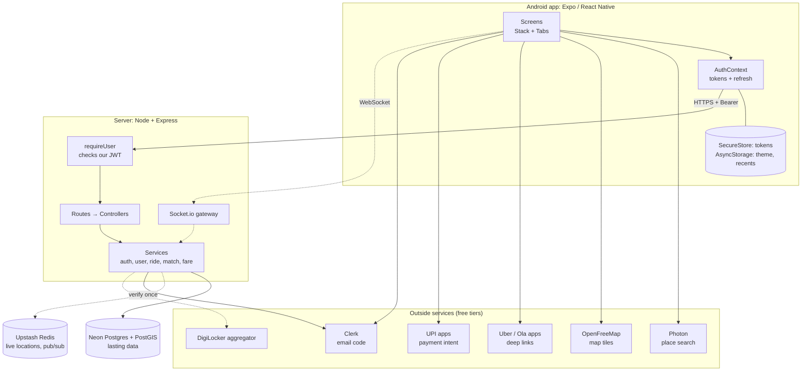
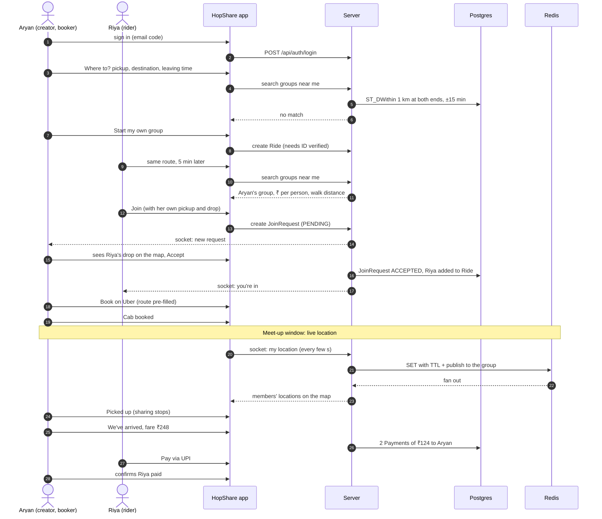
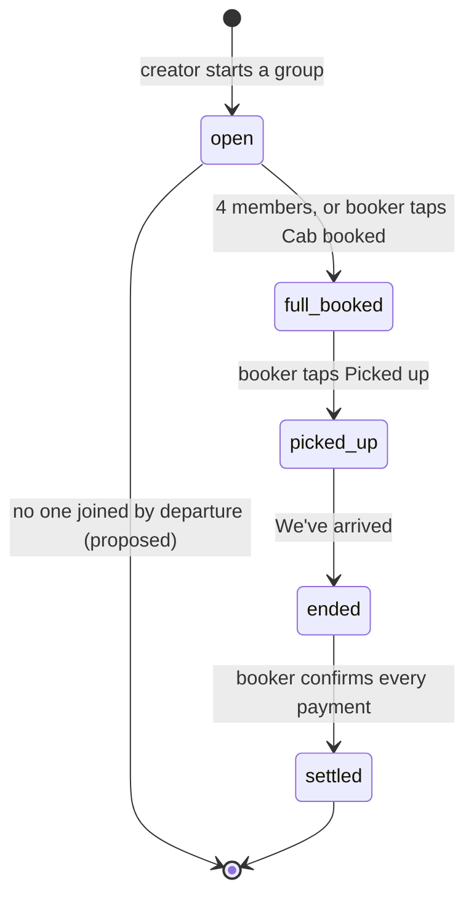
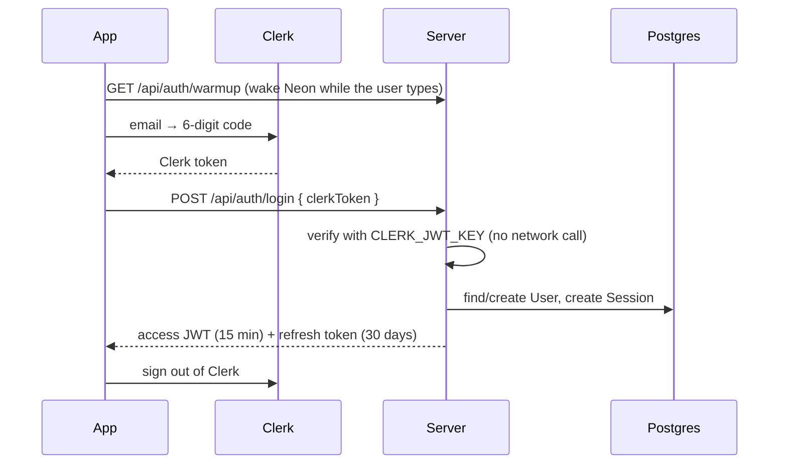
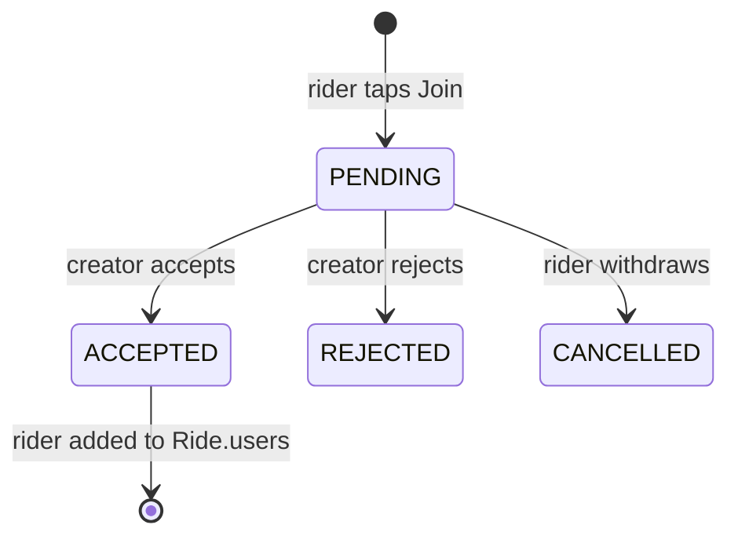
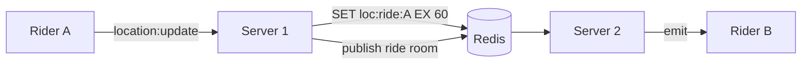
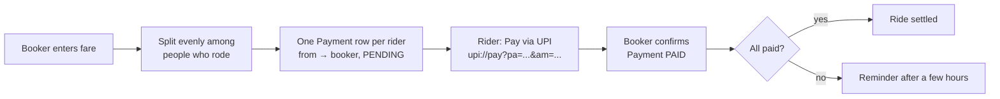

# HopShare system design, end to end

Updated 2026-11-19. Each part is marked **Built**, **Planned** (decided in the spec, not coded) or
**Proposed** (a suggested design, not decided yet). Product decisions come from
`docs/superpowers/specs/2026-10-26-unihop-app-design.md`; tables come from `docs/schema/schema.md`.

## 1. The problem in one paragraph

2–4 people near each other want to go to the same place at about the same time. HopShare finds them, groups
them, lets one of them book a normal Uber/Ola cab, keeps everyone safe while they meet up and ride, and makes
sure the booker gets paid back. HopShare **never books the cab and never holds money**, which keeps it free to
run and legally simple.

## 2. The big picture



| Part | Job | State |
|---|---|---|
| Expo app | All screens, GPS, maps, opening cab and UPI apps | Built: sign-in, profile setup, home map + search |
| Express API | Auth, profile, rides, matching, join requests, fares | Built: auth + `/api/me` |
| Socket.io | Group updates and live location in real time | Planned |
| Postgres + PostGIS (Neon) | Users, sessions, rides, join requests, payments; 1 km geo queries | Built (schema) |
| Redis (Upstash) | Short-lived live locations and pub/sub between server instances | Planned |
| Clerk | Checks the email code. Nothing else | Built |
| Photon / OpenFreeMap | Place search, reverse geocoding, map tiles | Built (called from the app) |
| DigiLocker aggregator | ID verification before joining a group | Planned |

**Layering on the server:** `routes → controllers → services → Prisma`. Controllers only read the request and
shape the response; all rules live in services, so the socket handlers can reuse them. Every error is
`{ "success": false, "message": "..." }`.

## 3. The journey of one ride



The same journey as ride states (spec 4.8a):



The rest of this doc goes through each step.

## 4. Sign-in and sessions (Built)

Clerk is used for one thing: proving the person owns the email. After that HopShare runs its own auth, so the
server controls sessions, logout and suspension, and Clerk's free tier limits don't matter after login.



- **Access token:** JWT with `sub` = user id and `sid` = session id. `requireUser` checks the signature, then
  checks the session isn't revoked and the user isn't suspended. That extra database read is what makes logout
  and suspension take effect at once.
- **Refresh token:** `"<sessionId>.<secret>"`. Only a SHA-256 of the secret is stored. Each refresh swaps in a
  new secret; if an old one shows up again, someone copied it, so the whole session is revoked.
- **App side:** tokens in SecureStore. On a 401 the app refreshes **once** (concurrent requests share the same
  refresh promise), then retries. Two parallel refreshes would look like token reuse and end the session.

## 5. Where to: places and maps (Built)

- Pickup defaults to GPS (`expo-location`), named with Photon reverse geocoding. The destination comes from
  Photon type-ahead, biased to the user's position.
- Map: MapLibre with OpenFreeMap tiles (free, no key), light and dark styles.
- Last 5 destinations are kept on the phone (AsyncStorage), since commutes repeat.
- **Planned:** move Photon behind `/api/places` so the app doesn't depend on a third-party URL and results can
  be cached.

## 6. Matching (Planned)

A group matches when **both** ends are close and the time fits:

- the group's pickup is within **1 km** of my pickup,
- the group's destination is within **1 km** of my destination,
- it leaves within **±15 minutes** of my leaving time, is still `joinable`, and has fewer than 4 members.

```sql
SELECT r.id, r."sourceName", r."destinationName", r.time,
       ST_Distance(r.source, ST_MakePoint($pickLon, $pickLat)::geography) AS walk_m
FROM "Ride" r
WHERE r.joinable
  AND r.time BETWEEN $leaving - interval '15 min' AND $leaving + interval '15 min'
  AND ST_DWithin(r.source,      ST_MakePoint($pickLon, $pickLat)::geography, 1000)
  AND ST_DWithin(r.destination, ST_MakePoint($dropLon, $dropLat)::geography, 1000)
ORDER BY r.time, walk_m
LIMIT 20;
```

- Points are `geography(Point, 4326)`, always `[lon, lat]`, so distances come out in metres.
- `ST_DWithin` can use a **GIST index** on `source` and `destination`. The indexes are left out for now (tiny
  data); they're the first thing to add when matching gets slow.
- Ordering: soonest departure first, then shortest walk (spec 4.4).
- Browsing needs no ID check; creating or joining does, and the **server** enforces it.

## 7. Joining a group (Planned, table built)



- The request stores the rider's **own** pickup and drop, so the creator can see on a map whether the detour
  makes sense before accepting.
- Accept runs in one transaction: check the ride is still joinable and has room, mark the request `ACCEPTED`,
  add the member, set `joinable = false` at 4.
- **Proposed:** a rider may have several pending requests; the first accept wins and the others become
  `CANCELLED`. Rule: one active group per user (spec 4.8a).

## 8. Real time: Socket.io and Redis (Planned)

**Connection:** the socket handshake sends the same access token as HTTP and goes through the same check as
`requireUser`. Each member joins a room per ride, `ride:<rideId>`.

**Proposed events:**

| Event | From → to | When |
|---|---|---|
| `join-request:new` | server → creator | a rider asks to join |
| `join-request:answered` | server → rider | accepted / rejected |
| `ride:updated` | server → room | member joins/leaves, cab booked, picked up, ended |
| `location:update` | phone → server → room | every few seconds, meet-up window only |
| `payment:updated` | server → room | someone paid / booker confirmed |

**Why Redis, not Postgres, for live location:**

- Positions change every few seconds and are worthless a minute later; writing them to Postgres is constant
  wasted writes and keeps serverless Neon awake.
- The privacy promise is that location isn't kept. A Redis key with a **TTL** (e.g. `loc:<rideId>:<userId>`,
  60 s) deletes itself.
- With several server instances, group members can be on different ones. Redis **pub/sub** (Socket.io Redis
  adapter) delivers each update to every instance.



**When location is shared:** from "group full / cab booked" until "picked up" for everyone in the group. After
that, only a rider who taps **Share trip** or **SOS** keeps streaming (spec 4.9). The phone stops sending
outside that window; the server ignores anything it still gets.

On the phone, location updates go into a ref and the map markers update without re-rendering the whole screen,
because they arrive several times a second across a group.

## 9. Booking the cab (Built, not yet on a screen)

HopShare can't book with Uber/Ola (their ride APIs are for partners only). The booker taps **Book on Uber** or
**Book on Ola**; the app opens with pickup and drop already filled (`uber://riderequest?...`,
`olacabs://app/launch?...`), with a web fallback if the app isn't installed. The booker comes back and taps
**Cab booked**, optionally adding the cab number and the cab app's trip-share link.

## 10. Safety (Planned)

- **ID verification:** DigiLocker through an aggregator. HopShare keeps only name, date of birth (18+ check) and
  a verified flag, never the Aadhaar number or documents.
- **Share trip:** a link to a public web page with live position and first names; it expires when the ride
  ends.
- **SOS:** hold 3 s → call 112, open the SMS app with trusted contacts and the trip link, flag the ride for
  review. It does **not** alert the group. Automatic SMS needs a paid provider, so it's v2.
- **Privacy:** other riders only see first name, photo and badges. Never phone, last name or address.

## 11. Fare split and payback (Planned)



- Even split, no-shows excluded. Amounts are worked out in paise (integers) to avoid rounding errors.
  **Proposed:** any leftover paise stay with the booker.
- HopShare never moves money: the UPI intent opens the rider's own UPI app with the booker's UPI ID and amount.
  If it reports success, the row is marked "probably paid"; the **booker's confirmation** is the truth.
- Payments sit behind one service, so a gateway (e.g. Razorpay) could be added later without changing screens.

## 12. Deployment, cost and scale

| Piece | Where | Cost |
|---|---|---|
| App | Android APK (Expo development build) | Free |
| API + sockets | Render / Koyeb free tier | Free |
| Postgres + PostGIS | Neon serverless | Free tier |
| Redis | Upstash serverless | Free tier |
| Auth, maps, search | Clerk, OpenFreeMap, Photon | Free |

Free tiers sleep when idle, so the server and Neon may need a few seconds to wake. The warmup call on the
sign-in screen hides that wait.

**If it grew:**
1. Add GIST indexes on ride points (matching stays fast).
2. Run more than one server instance: possible because auth is stateless JWT and sockets share state through
   Redis.
3. Run our own Photon or cache searches behind `/api/places`.
4. Move live-location writes fully off Postgres (already the design).

## 13. Key trade-offs (the "why" in one place)

| Decision | Why | Cost of it |
|---|---|---|
| Hand off to Uber/Ola instead of booking | No partner API access; no liability | Can't read trip status; booker taps "Cab booked" |
| UPI links instead of a payment gateway | Free, no KYC, never hold others' money | Payment isn't guaranteed; booker confirms |
| Clerk only for the email code, own tokens after | Control over sessions, logout, suspension; Clerk limits only touch login | We own token security (hashing, rotation, reuse check) |
| Session check on every request | Logout and suspension are instant | One extra DB read per request |
| Redis for live location | Fast, auto-expiring, works across servers | One more service to run |
| Even split only | Simple and easy to trust | Unfair if someone gets off much earlier |
| PostGIS on both ends of the ride | One SQL query, real distances in metres | Needs `[lon, lat]` discipline and indexes later |
